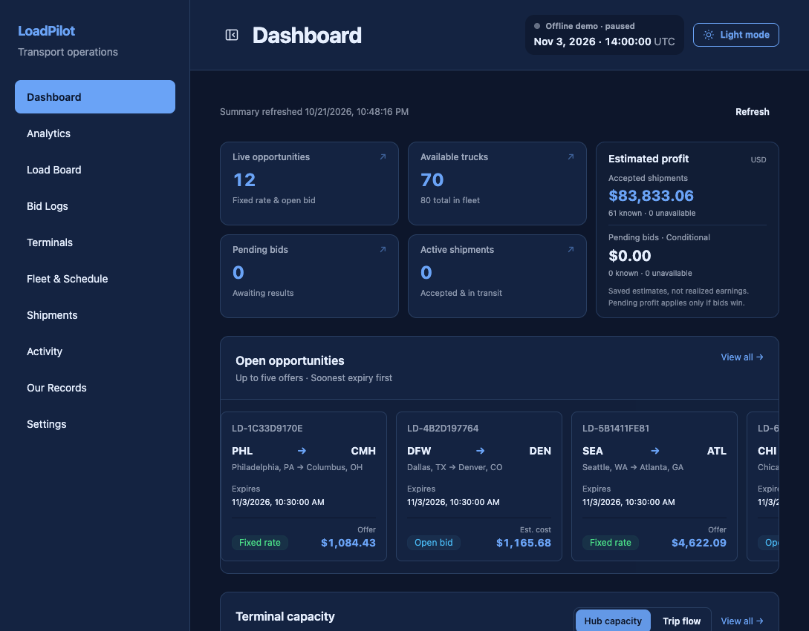
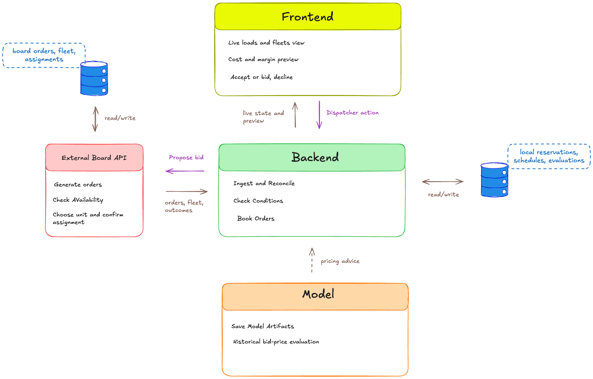
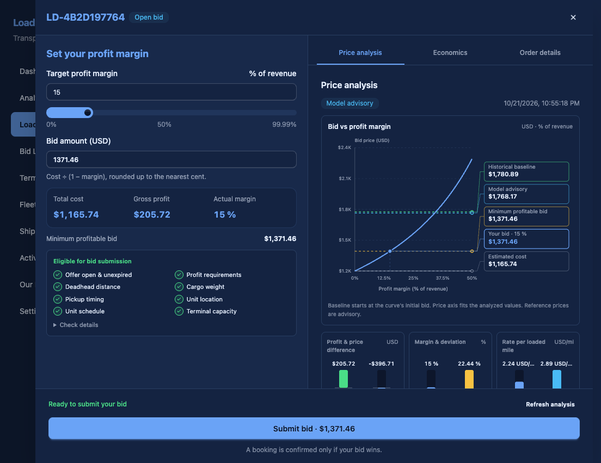
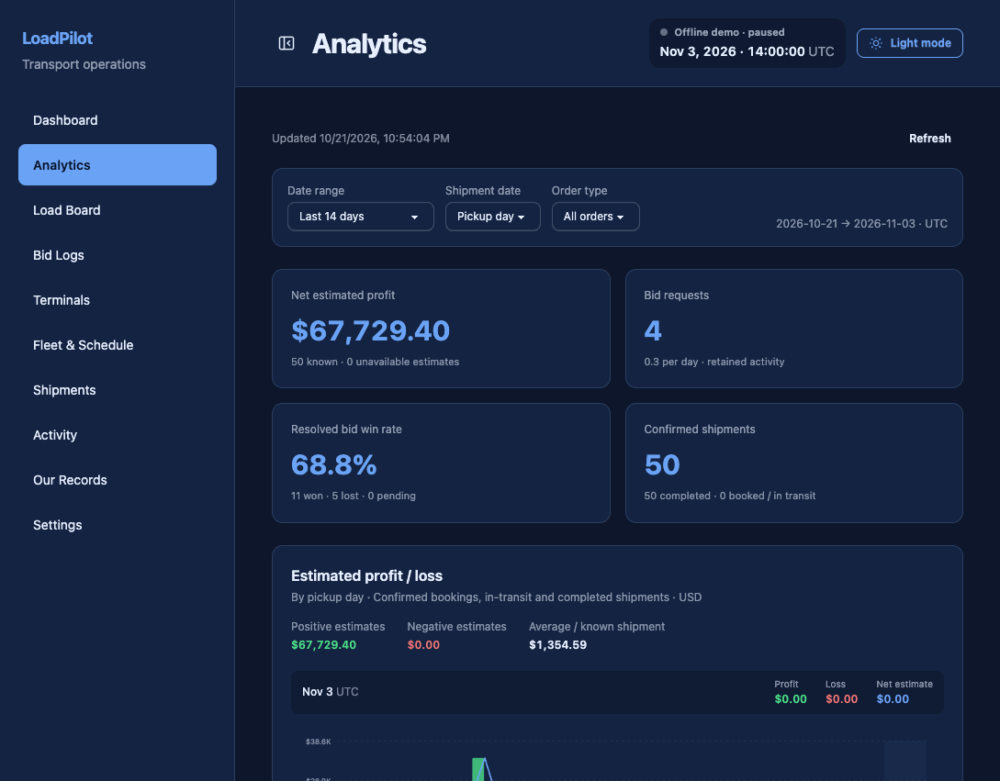
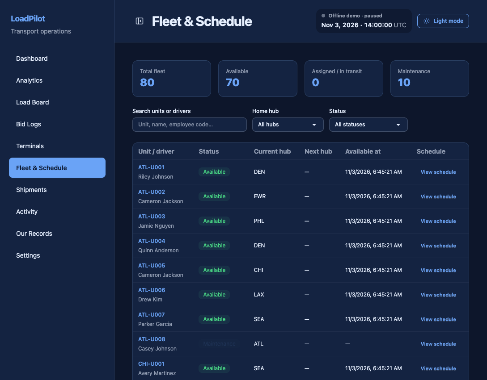
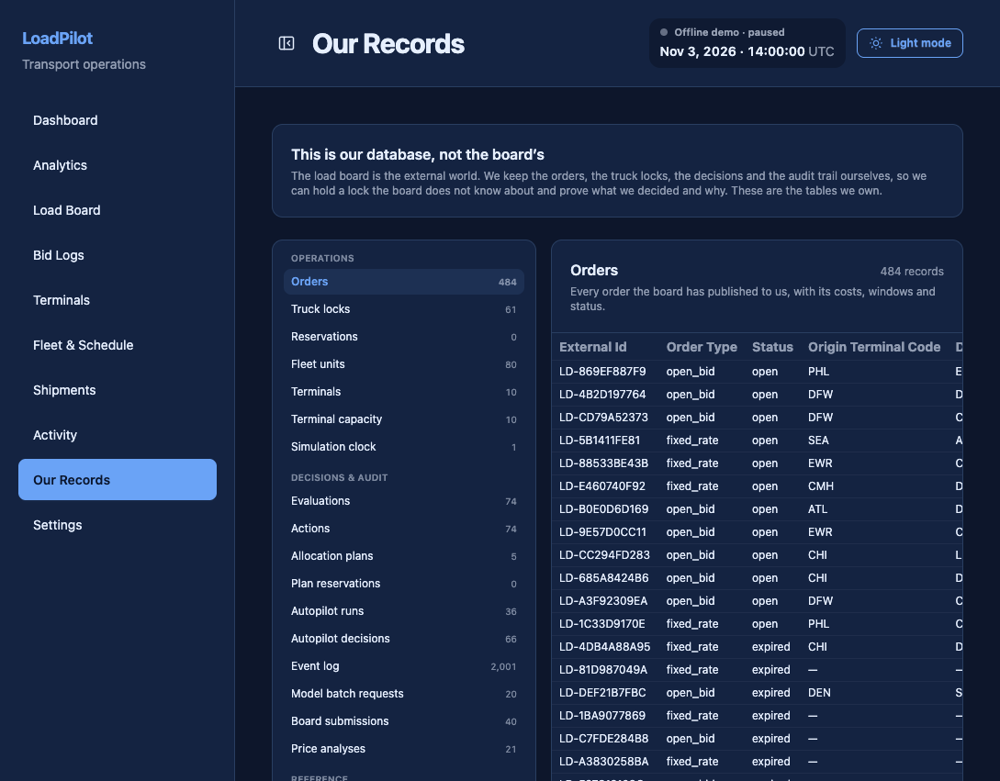
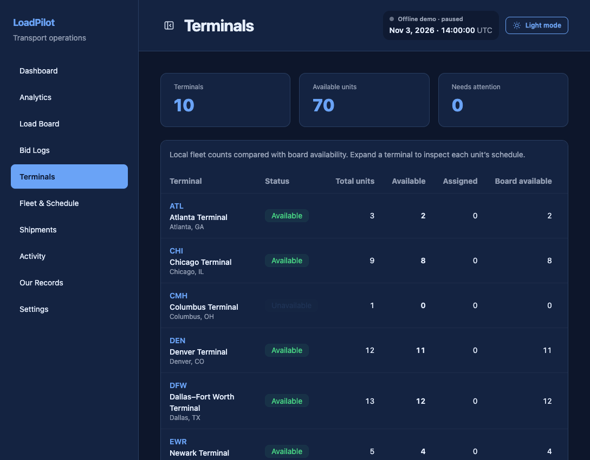
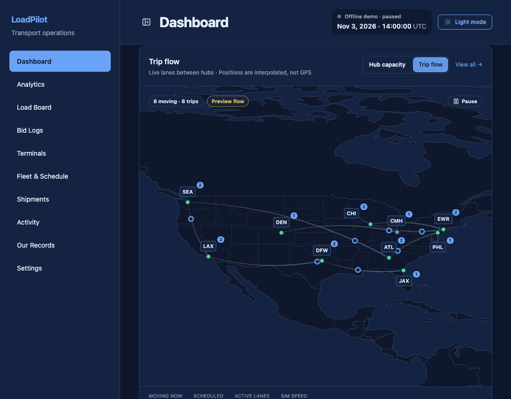

# LoadPilot

**Freight dispatch, priced and scheduled.** LoadPilot reads a live load board, decides which loads are worth taking, assigns the right truck, prices open bids with a trained model, and records every decision it makes.

[](https://www.python.org/)
[](https://fastapi.tiangolo.com/)
[](https://react.dev/)
[](https://pytorch.org/)
[](https://github.com/Harkiran11/load_pilot/actions/workflows/ci.yml)
[](#testing)
[](LICENSE)



## What it does

A dispatcher's job is a stream of trade-offs: take this load or wait for a better one, send this truck or deadhead a cheaper one, bid low enough to win but high enough to make margin. LoadPilot turns those trade-offs into explicit, inspectable rules and runs them against live data.

- **Live ingestion.** Snapshot on startup, WebSocket updates while running, and periodic reconciliation to recover from missed events. Orders are idempotent on the board's `external_id`.
- **Dispatch decisions.** Eight fail-closed checks per load: offer validity, profit floor, deadhead cap, pickup timing, cargo weight, unit schedule, terminal capacity, and truck availability. A missing or stale input means *do not book*.
- **Occupied-window locking.** A truck is reserved for the full interval it is actually busy: empty travel to pickup, the loaded trip, and turnaround. The lock and the booking commit in one transaction, so two dispatchers cannot double-book the same truck.
- **Bid pricing.** A PyTorch model estimates market rate per mile from lane, distance, weight, equipment, and history. Deterministic cost and margin rules remain the final authority; the model advises, it does not overrule the floor.
- **Autopilot.** An optional worker can accept fixed-rate loads and submit open bids without a click. It runs through the same checks as a human action, behind two independent safety gates and hard limits on orders, spend, and time.
- **Audit trail.** Every evaluation, reservation, submission, and outcome is stored locally with the inputs that produced it. The "Our Records" screen exposes the dispatcher's own database, not the board's.

The system is built to be live: it runs against a board over REST and WebSocket, writes to its own relational ledger, and exposes a React dispatcher UI on top.

## Architecture



| Service | Role |
|---|---|
| `frontend` | React 19 + TypeScript SPA, built with Vite and served by nginx |
| `backend` | FastAPI REST + WebSocket API, background workers, SQLAlchemy, SQLite in WAL mode |
| `model` | FastAPI pricing service with a saved PyTorch bundle and baseline artifacts |
| board | External load board (REST + WebSocket). Optional for the bundled demo. |

The backend owns the product's memory and policy. The board owns orders, fleet availability, and final assignment; it can still reject a request with `409`, so every submission is revalidated immediately before it is sent.

## Engineering highlights

### Streaming: 24.1 MB to 71 KB per update

The first version sent every retained order to every connected screen once a second. With six screens open, one message was **24.1 MB** and the server produced roughly **144 MB/s** of WebSocket traffic. The fix was not a bigger pipe:

- the live stream now carries only the actionable set (open, unexpired orders) instead of the full retained history;
- screens that only need the clock subscribe with `loads=false` and receive a **~1 KB** clock message;
- the payload is built once per tick and fanned out, rather than serialized per connection.

One update dropped from 24.1 MB to **71 KB** (about 340× smaller). Clock-only subscribers receive about 1 KB.

### Scheduling that cannot double-book

Availability is not a boolean. A truck that is free at 09:00 may be unable to reach a 09:30 pickup 200 miles away. LoadPilot projects the unit's position, computes the full busy interval, and writes an occupied-window lock in the same transaction as the booking. Overlapping windows fail the constraint instead of overwriting it.

### Analytics and logs served from the database

The analytics page originally downloaded and aggregated raw rows in the browser. It now runs grouped queries server-side: **0.2–0.3 s** for the dashboard, **6–24 ms** for paged bid logs, and **0.1–1.2 s** for a cost preview that includes the model call.

### A model with a measured baseline

The pricing model is evaluated against two simple baselines on a held-out test set:

| Model | MAE per load | MAE per mile |
|---|---:|---:|
| Global median | $461.77 | — |
| Lane median | $368.26 | — |
| **LoadPilot RPM model** | **$297.35** | **$0.2748** |

That is roughly **36% better than the global median** and **19% better than the lane median**. The repository ships the frozen bundle, its feature schema, the training manifest, and the evaluation output. The model service refuses to load a bundle whose artifact checksums or feature-contract hashes do not match.

### SQLite, deliberately

The dispatcher uses SQLite in WAL mode with `PASSIVE` checkpoints. For a single-writer dispatch service this removes a network hop and makes the demo reproducible with one file. The trade-off is documented: the write path is serialized, so a multi-node deployment would move the ledger to PostgreSQL and keep the same repository interfaces. Backups use SQLite's online backup API (about 1.6 s for the 1.1 GB production-shaped database) rather than copying a live WAL file.

## Screens

| Load board and bid pricing | Analytics |
|---|---|
|  |  |

| Fleet and schedule | Our records |
|---|---|
|  |  |

| Terminal capacity | Trip flow |
|---|---|
|  |  |

## Quick start

Requires Docker. No API keys, cloud accounts, or local Python/Node install.

```bash
git clone https://github.com/Harkiran11/load_pilot.git
cd load_pilot
./start.sh
```

Or with Compose directly:

```bash
docker compose up --build -d
```

Open **http://localhost:5173**. The API is at **http://localhost:8000**, with OpenAPI docs at **/docs**.

The first run seeds a captured demo dataset: **484 orders**, **80 trucks**, **10 terminals**, and **2,500 historical shipments**. The dataset is synthetic, produced by a load-board simulator; it contains no customer data.

### Demo mode vs. live mode

The bundled demo is intentionally offline:

- the simulation clock is paused so the dataset stays reproducible;
- the load board, analytics, fleet, records, and pricing screens are fully explorable;
- booking and bidding require a board, because those actions change external state.

To run against a compatible board, set its base URL and rebuild:

```bash
EXTERNAL_API_URL=http://your-board:8087 docker compose up --build -d
```

The backend then enables ingestion, clock sync, and submission. The board contract is REST for snapshots and WebSocket for live events; the dispatcher never assumes the board is available.

> The board simulator is not part of this repository. The dispatcher is the product; the board is an external dependency. The bundled `backend/data/seed.db` is a frozen capture used by the offline demo.

## Testing

```bash
make test    # backend + model suites
make lint    # ESLint and TypeScript
```

- **34 backend tests** cover the schema/migration contract, dispatch policy, scheduling and occupancy, health checks, and startup recovery.
- **212 model tests** cover feature contracts, bundle integrity, prediction parity, fallback policy, and live audit rules.
- Six contract-example tests skip when the published API fixtures are absent.

The frontend is type-checked with `tsc -b` and linted with ESLint; the production bundle is built in CI-style Docker builds.

## Repository layout

```text
backend/
  controller/     HTTP and WebSocket endpoints, grouped by domain
  schema/         SQLAlchemy models and request/response contracts
  service/        ingestion, dispatch, pricing, allocation, autopilot, audit
  migrations/     Alembic migrations
  tests/          backend test suite
frontend/
  src/api/        typed API clients and WebSocket wrapper
  src/pages/      dashboard, load board, analytics, fleet, records, settings
  src/components/ reusable UI, charts, and the trip-flow map
model/
  loadpilot_model/  features, regressor, inference bundle, evaluation
  artifacts/        frozen model bundle, baselines, manifests
  tests/            model test suite
docker/           Python and frontend images, nginx config, health checks
docs/             architecture, engineering notes, code map, screenshots
scripts/          database inspection helpers
```

## Design decisions

**Fail closed, not best effort.** A stale fleet snapshot, an unknown terminal, or an unresolved cost produces a rejection with a reason code. Silently guessing is how dispatch systems double-book trucks.

**The model advises; rules decide.** Rate prediction is useful, but a profit floor and a capacity check are not probabilistic. The model returns a price and an uncertainty note; the dispatcher enforces the floor and the schedule.

**Server-side aggregation.** The browser should render decisions, not compute them. Analytics, bid logs, and record browsing are paginated and aggregated in SQL.

**Two safety gates for autonomy.** The backend and the model service each require their own enable flag, kill switch, and token. Either side can stop autopilot without a deploy.

**Measured, not asserted.** Performance and model numbers in this README come from the engineering report and the checked-in evaluation artifacts. The report records the before/after for each optimization.

## Documentation

- [Engineering report](docs/ENGINEERING.md) — constraint logic, scheduling, model evaluation, reliability work, and scale path
- [Code map](docs/CODE-MAP.md) — what every folder and service does
- [Feature coverage](docs/FEATURES.md) — capability-by-capability implementation notes
- [Architecture diagrams](docs/diagrams/) — system, backend workflow, ERD, and model flow

## License

MIT. See [LICENSE](LICENSE).
