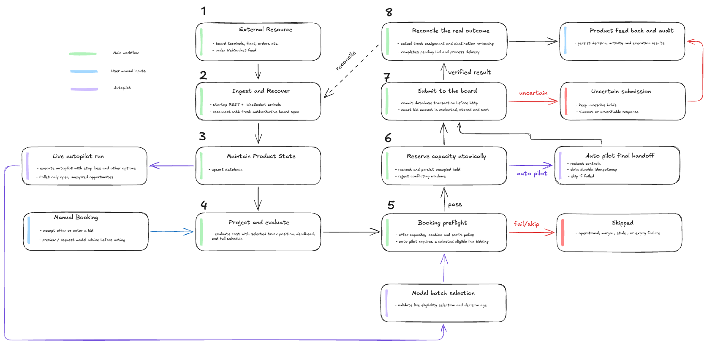
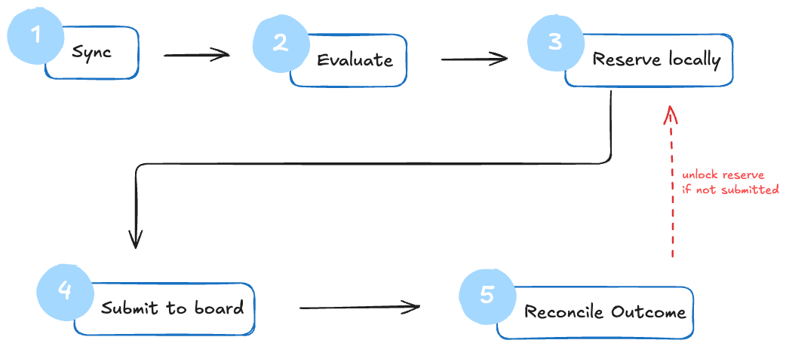
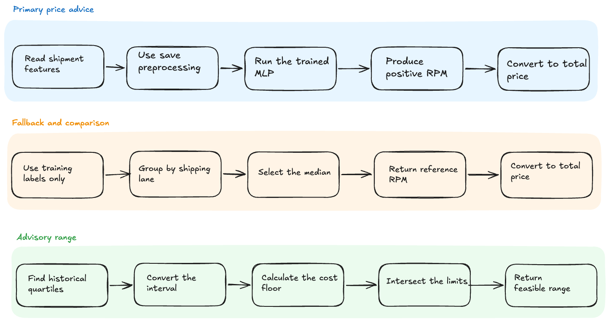

# Engineering & Business Report

**LoadPilot — freight dispatch, pricing, and scheduling**

This report covers the engineering behind LoadPilot: constraint logic, time-window
scheduling, empty-mile optimization, use of historical data, the balance between
volume and profitability, and the path to enterprise scale. It also records the
reliability and performance work that makes the system repeatable.

---

## 1. Executive summary

We built a working freight-dispatch product, not a mock-up:

- A **React dispatcher UI** with live fixed-rate and open-bid queues, bid entry,
  margin analysis, fleet/schedule views, terminal utilization, shipment tracking,
  analytics, audit activity, and autopilot controls.
- A **FastAPI backend** with its own relational schema, atomic capacity locks,
  idempotent board ingestion, a simulation-aware clock, auditable decisions, and
  guarded live submission.
- A **PyTorch RPM model** used as advisory pricing for open bids, with deterministic
  cost/margin rules remaining the final authority.
- A **guarded autopilot** that can accept fixed-rate loads and submit open bids
  without a click, but only after the same operational checks a human action uses.

Core outcomes:

| Area | Result |
|---|---|
| Capacity safety | Full occupied-window locks (empty travel + loaded trip + turnaround) in one database transaction |
| Board correctness | Board-selected unit is predicted; submissions are revalidated immediately before sending |
| Profitability | Deterministic profit, margin, bid-floor, deadhead, weight, timing, capacity, and freshness checks |
| Empty miles | Projected unit position at pickup, not current position; configurable deadhead cap and chaining |
| Ingestion | Startup snapshot + WebSocket events + periodic reconciliation; idempotent on board `external_id` |
| Optional ML | Trained RPM model with saved baselines, historical range, and honest test metrics |
| Optional autopilot | Live-gated, loss-budgeted, time/order-limited, fully audited worker |
| Verification | 34 backend tests; browser-verified Load Board analysis and autopilot submissions |

The design principle throughout is **fail closed**. Missing costs, stale snapshots,
unresolved terminals, overlapping locks, unknown units, or an unapproved model
decision mean "do not book", never a silent guess.

---

## 2. System architecture


The runtime has four containers:

| Service | Role |
|---|---|
| `frontend` | React 19 + Vite dispatcher application |
| `backend` | FastAPI API, background workers, SQLite dispatcher database |
| `model` | FastAPI pricing/decision service and saved PyTorch bundle |
| board | External load board, fleet inventory, history, simulation clock (optional in the offline demo) |

The backend is the product's memory and policy layer. The board is the
external world: it can still reject a request with HTTP 409, and it owns final unit
assignment. Our database is not a copy of the board; it holds our orders, units,
locks, evaluations, submissions, outcomes, and audit trail.



### Request and worker paths

- **Read path:** API/WebSocket reads use ordinary SQLite read transactions. Reads
  do not take the writer lock.
- **Write path:** a booking decision opens `BEGIN IMMEDIATE`, revalidates, writes the
  reservation/assignment, commits, and only then calls the board.
- **Background path:** ingestion, clock sync, expiration monitoring, reconciliation,
  WAL checkpointing, and the autopilot worker run as supervised asyncio tasks in the
  backend process for this single-node demo.

---

## 3. Relational state and time-window locks

The canonical schema is documented in
[`backend/requirements/database-schema.md`](../backend/requirements/database-schema.md)
and the ERD is in [`docs/diagrams/erd-diagram.png`](diagrams/erd-diagram.png).

Key table groups:

| Group | Tables |
|---|---|
| Board/domain state | `shipments`, `terminals`, `fleet_units`, `fleet_capacity`, `simulation_clock` |
| Scheduling | `assignments`, `assignment_reservations`, `fleet_allocation_reservations`, `dispatch_actions` |
| Decisions | `evaluations`, `autopilot_runs`, `autopilot_attempts`, `allocation_plans` |
| Analytics/audit | `activity`, `live_batch_audits`, `prediction_observations`, `historical_shipments`, `observed_cohorts`, `observed_comparisons` |

Important properties:

- `shipments.external_id` is the idempotency key for board orders. Replaying the
  same WebSocket/REST message updates one row, never creates duplicates.
- Foreign keys protect unit, terminal, shipment, and action references.
- Alembic migrations are checked against both the SQLAlchemy models and the schema
  guide by `tests/test_database.py`.
- JSON policy/response snapshots preserve the exact inputs behind a decision for audit.
- The simulation clock is a single row (`clock_id = 1`) with a revision. Expiration
  and occupancy comparisons use **simulated** time, not wall time.
- Audit, allocation-plan result, and prediction tables are append-heavy and are
  deliberately excluded from the operational allocation snapshot.

### The occupied window

A unit is not locked only for the loaded trip. It is locked from the time it must
leave its projected position until it is free again after delivery:

```text
departure = pickup_at − ceil(deadhead_miles / assumed_speed +
                             pickup_buffer_minutes / 60)

occupied_from  = departure
occupied_until = delivery_at + turnaround_minutes
```

Defaults: 45 mph assumed travel speed, 0 pickup buffer, 30-minute turnaround. The
formula is implemented with decimal/integer microseconds and rounds travel time
**outward**, so a reservation can never under-book a fractional minute.

Two windows conflict when:

```text
existing.occupied_from < candidate.occupied_until
AND
existing.occupied_until > candidate.occupied_from
```

Touching endpoints are free. The overlap query covers:

1. Active assignments (`planned`, `active`, `in_transit`, etc.).
2. Completed assignments whose retained tail still blocks a future window.
3. Pending assignment reservations tied to dispatch actions.
4. Fleet-allocation holds that have not been submitted yet.
5. The action currently being edited is excluded from its own conflict set.

### Board-selected unit

The board assigns the **nearest free unit at the origin hub**. We do not invent a
different truck. The backend predicts the board's choice using the board's distance
rounding and employee ordering, then evaluates that unit. If the candidate differs
from the board-selected unit, the action is rejected (`unit_not_board_selectable`).
This keeps our locks aligned with the capacity the board will actually consume.

After booking, a unit is re-homed to the delivery hub (or the nearest hub for an
off-pin drop). That is how the sandbox models network flow, and it is why future
loads at the destination are evaluated with a **projected** position rather than
the unit's current location.

---

## 4. Real-time ingestion and reconciliation



The ingestion pipeline is deliberately redundant:

1. **Startup snapshot** — full REST read of orders, fleet, terminals, and clock.
2. **WebSocket events** — new orders and lifecycle changes are applied immediately.
3. **Periodic REST sync** — every 30 seconds, authoritative reconciliation catches
   missed events, board removals, and lifecycle drift.
4. **Clock sync** — every second, simulated time and speed are refreshed.
5. **Expiration monitor** — every second, offers past their simulated expiry are
   marked expired.
6. **Lifecycle reconciliation** — websocket bursts are coalesced; full board
   reconciliation is throttled to avoid write starvation while still updating the
   affected order immediately from the event payload.

All writes are idempotent. If the WebSocket disconnects, the REST snapshot restores
truth. If the backend restarts, startup recovery re-reads the board and reconciles
open actions. A board action with an unknown outcome keeps its reservation held and
is reconciled from the board later; the system never silently frees capacity that
may have been consumed.

### Why the clock is separate

The simulation clock changes four times more often than orders. Writing the clock
inside every order reconciliation would create unnecessary writer contention.
The clock is therefore a small independent row, and order/reconciliation writes own
their own transactions. In the final build the clock and expiration cadences are
1 second, which is accurate enough for a 10× demo and much cheaper than the original
quarter-second churn.

---

## 5. Empty-mile and continuity optimization

### Deadhead

For an open or fixed-rate load, the backend computes the empty distance from the
candidate unit's **projected position at pickup time** to the shipper's origin. This
is stricter than using the unit's current position, because a unit may finish another
load first.

- Distance: haversine miles.
- Deadhead cost: `projected_deadhead_miles × cost_per_mile`.
- Board total cost: loaded cost + deadhead cost.
- Default cap: `MAX_DEADHEAD_MILES=100`.
- The UI shows empty miles and estimated deadhead cost before booking.

The board's own nearest-unit calculation is used only to predict **which** unit the
board will assign. The economics use our projected mileage, so the profit estimate
reflects the actual empty move.

### Chaining

`project_units()` simulates each unit's future position from its active assignments
and retained locks. At the candidate pickup time it answers: "Where will this truck
be, and when is it free?" A unit that is currently in Atlanta but will deliver in
Chicago tomorrow is evaluated as a Chicago-area unit for a Chicago pickup.

This enables load chaining:

```text
Load A: ATL → CHI, delivered by 14:00
Load B: CHI → DEN, pickup 16:00
→ unit is projected at CHI, empty miles are local, no deadhead back to ATL
```

Units that cannot reach the pickup, are still busy, have conflicting reservations,
or exceed the empty-mile cap are rejected with explicit reason codes. A future
terminal can be recognized as a chaining opportunity, but the action is still
blocked if the board has not yet made that unit selectable.

### Fleet allocation

The planner takes a bounded set of candidate orders (default 12) and searches for a
set that maximizes projected profit while respecting one order and one unit per
slot. It runs a bounded depth-first branch-and-bound search (2,000 nodes / 2 CPU
seconds by default) against a **selective in-memory operational snapshot**, using
savepoint-backed virtual bookings so later candidates see earlier holds.

The model service then solves the order↔truck matching problem exactly with
successive shortest augmenting paths on a residual flow graph. Unlike a greedy
"best pair first" matcher, it can undo an earlier pairing when a better global set
exists. The planner is advisory: every chosen action still goes through the normal
reservation and fresh-check path.

### Reliability note

The original planner copied the entire dispatcher database into memory. With a
1.9 GB audit/prediction history that caused container memory pressure. The final
snapshot copies only the 15 small operational tables (a few megabytes) and rebuilds
the schema in SQLite. This removed the restart/OOM failure mode without weakening
the planner's transaction isolation.

---

## 6. Profit and margin logic

All money is calculated with fixed decimal arithmetic. The core economics are:

```text
loaded_cost   = estimated_cost
                (fallback: distance_miles × cost_per_mile)

deadhead_cost = projected_deadhead_miles × cost_per_mile

total_cost    = loaded_cost + deadhead_cost
                (+ configured opportunity / positioning adjustments)

gross_profit  = payout − total_cost

margin_pct    = gross_profit / payout × 100
```

For open bids, `payout` is the proposed bid. For fixed-rate loads, it is the posted
offer. The **minimum profitable bid** is the larger of:

```text
total_cost + minimum_profit_usd
total_cost / (1 − minimum_margin_pct / 100)
```

rounded up to the cent. Defaults are $0 minimum profit and 15% minimum margin. If
the required margin is 100% or costs are unknown, the floor is unavailable and the
action fails closed.

Two adjustments make the estimate more realistic without replacing the hard floor:

- **Opportunity cost** — default $25/hour of occupied time, because a truck tied up
  on a long load cannot take other work.
- **Positioning value** — a capped credit (25% of the estimated repositioning value,
  max $500) when a load moves the truck to a more useful terminal.

Historical comparables (state pair + origin/destination radius, at least 5 samples,
365-day lookback) provide context and warnings. They do not override the
deterministic margin rule.

---

## 7. Historical data and pricing model



The provided historical dataset was used offline to train and evaluate a pricing
model. The saved bundle records the exact data hashes, features, baseline results,
and test metrics, so the demo does not depend on a hidden notebook state.

### Dataset and split

- Chronological split to avoid future leakage: **756 train / 162 validation /
  163 test** rows.
- Typical fields: distance, weight, coordinates, lane, origin/destination state,
  offered/bid rate, cost per mile, estimated cost, won, and margin.
- Final encoded feature vector: **114 features** (scaled numeric fields plus lane and
  state indicators).
- Network: two hidden layers (32, 16); target is **RPM** (USD per loaded mile), not
  profit or acceptance.

### Metrics

| Partition | Model MAE | Global-median MAE | Lane-median MAE | Coverage |
|---|---:|---:|---:|---:|
| Validation (162) | $301.28 | $527.32 | $362.15 | 100% |
| Test (163) | $297.35 | $461.77 | $368.26 | 100% |

The saved comparison also records MAE per mile (about $0.27 on test). The model
beats the global median by roughly 36% and the lane median by roughly 19% on test
dollar error.

### How it is used

- **Load Board analysis:** model RPM × loaded miles gives an advisory total bid;
  the UI compares it with the deterministic bid floor and a historical range.
- **Market context:** imported historical shipments can be queried by directed state
  pair and a 100-mile endpoint radius. Won payouts/rates produce descriptive
  statistics and a historical win fraction; the sample count is shown and
  insufficient samples produce warnings, not false precision.
- **Manual bid scenarios:** dispatchers can see model price, history, and floor side
  by side before submitting.
- **Autopilot:** the model can return BID, REVIEW, or SKIP for a candidate pair.
  REVIEW and SKIP are never silently converted into a booking.

### Honest limits

- The bundle is marked **unverified** and is not a claim of realized profit.
- Lanes are sparse; the test set has already been consumed for evaluation.
- The simulator's open-bid award outcome is independent of bid amount. Win rate is
  therefore not a valid optimization target; protecting margin is.
- Missing data always yields REVIEW, never an invented price.

### Historical data import

The dispatcher supports an atomic CSV import through `HISTORY_CSV_PATH`. The file is
validated row by row, deduplicated by source key, and imported only when its SHA-256
changes. The import is optional in the demo; the model's saved artifacts and
historical range still provide advisory context without it.

The demo ships it enabled. The simulator publishes its history at
`/history/shipments.csv`; saving that file to `backend/data/historical_shipments.csv`
and pointing `HISTORY_CSV_PATH` at the mounted copy imports the whole dataset
(2,500 rows) on startup. That is what makes the **historical range** in the open-bid
panel real rather than empty: for a sampled lane it reports the historical median
payout and rate per mile, the sample count, and the lane's historical win fraction —
with the honest caveat that live sandbox awards are independent of the bid amount.
It also gives the model monitoring report its comparison population.

---

## 8. Booking volume vs. profitability

The product is intentionally optimized for **profitable utilization**, not submitted
volume or win rate.

### Fixed-rate loads

A dispatcher may accept only when all eight checks pass. The backend does not
auto-decline orders on the dispatcher's behalf: a human can still decline, but the
system never books a weak load just because the board would accept it.

### Open bids

The model price and historical context are advisory. The hard constraints are:

1. payout (bid) must cover the computed total cost;
2. gross profit must meet the dollar threshold;
3. margin must meet the percentage threshold;
4. empty miles must be within the cap;
5. weight, timing, capacity, location, and freshness must pass;
6. the bid must not exceed the configured run cap.

A low bid that wins an auction is not a success if it loses money. A higher bid that
loses is also not automatically a failure. The system reports submissions, wins,
losses, and actual financial outcomes separately.

### Pending exposure and loss budget

A submitted action is not yet a win. Its capacity is reserved, and any estimated
negative exposure counts toward the run's pending exposure. The autopilot stops
before the configured loss budget is crossed; zero means no known loss is allowed.
This prevents a sequence of "maybe" bids from creating unbounded downside.

### Autopilot limits

| Control | Default | Purpose |
|---|---|---|
| `max_orders` | 10 | Cap successful reservations/submissions |
| `max_duration_seconds` | 1800 **simulated** seconds | Run deadline; 10× demo ≈ 3 real minutes |
| `max_estimated_loss_usd` | 0 | Stop before known/pending loss exceeds budget |
| `min_expected_profit_usd` | 0 | Per-order dollar floor |
| `min_expected_margin_pct` | 15 | Per-order margin floor |
| `max_deadhead_miles` | 100 | Empty-mile cap |
| `max_bid_rate` | required for open bids | Bid ceiling |
| `min_action_interval_seconds` | 5 simulated seconds | Pace submissions |
| `max_consecutive_errors` | 3 | Stop on repeated failures |

The run records its stop reason (`order_limit_reached`, `time_limit_reached`,
`loss_budget_exceeded`, `kill_switch_active`, `consecutive_error_limit_reached`,
etc.) and shows it in the UI and activity log.

### Measuring what happened

- `assignments` and `shipments` track the booking through accepted, in transit, and
  completed.
- `evaluations` preserve the checks and economics used at decision time.
- `dispatch_actions` and `autopilot_attempts` preserve the actual submission and its
  result.
- `observed_cohorts` / `observed_comparisons` compare predicted economics with
  reported actuals once outcomes are known.
- Activity and audit tables make every automated action explainable after the fact.

---

## 9. Guarded autopilot implementation

The autopilot uses the same path as a manual booking, with extra gates:

```text
live enabled + kill switch off + shared token
        ↓
run settings validated / order collection window
        ↓
fresh board snapshot + selective allocation snapshot
        ↓
model batch matching (optional) + per-order model decision
        ↓
begin_action: fresh dispatch checks + atomic reservation
        ↓
authorize_attempt: model approval still valid and bindings intact
        ↓
revalidate immediately before send
        ↓
submit to board → reconcile accepted / rejected / unknown
```

Safety properties:

- **Two independent switches:** backend live enablement plus the model service's
  live gate; both must be enabled, with a kill switch off.
- **Shared secret:** at least 32 non-whitespace ASCII characters, compared in
  constant time; the secret is never returned to the browser or written to logs.
- **No volatile fingerprint gate:** fleet positions and capacity counts change on
  every sync. The autopilot therefore does not reject a plan just because a snapshot
  hash changed. Instead, it re-evaluates the actual order/unit pair, re-checks the
  clock and freshness, and revalidates immediately before sending. The plan is
  invalidated if the first assignment changed.
- **No invented capacity:** the board-selected unit and its occupied window must
  pass all local checks; the board can still return 409.
- **No automatic declines:** the worker only accepts or bids. It never declines an
  order on a dispatcher's behalf.
- **Bounded work:** order limit, simulated-time deadline, loss budget, action
  spacing, error limit, allocation node/time limits.
- **Full audit:** each attempt records the shipment, unit, order type, decision,
  bid/offer, estimated economics, reason codes, model snapshot, dispatch checks, and
  final board result.

---

## 10. Scaling to an enterprise deployment

The current single-node design is appropriate for a demo and small dispatch desk.
The following changes are the path to production scale without changing the domain
logic.

### Database and locking

- Move from SQLite to **PostgreSQL**.
- Keep the same occupied-window model, but enforce it with a GiST exclusion
  constraint, for example:

  ```sql
  EXCLUDE USING gist (
    unit_id WITH =,
    tstzrange(occupied_from, occupied_until, '[)') WITH &&
  )
  ```

- Use row-level locks or `SERIALIZABLE` transactions for the read-check-write
  sequence.
- Partition `dispatch_actions`, `live_batch_audits`, `prediction_observations`, and
  plan history by time; keep the operational tables small and indexed.

The demo's own measurements are the argument for this. On the 10× board the
dispatcher ran a board sync, a clock sync, an expiry monitor, an order stream
and the autopilot worker — all of them writers — against one SQLite file. Once
the audit rows were fixed, the worst write-lock wait was still 1.4 seconds and
most requests queued behind it. A single-writer database is the binding
constraint here, not CPU: the same workload on PostgreSQL would let the board
sync, the clock sync and a price analysis proceed concurrently, each taking
row-level locks instead of a global one.

### Services and ingestion

- Separate the API, ingestion worker, scheduler/autopilot worker, reconciliation
  worker, and model service into independently scalable deployments.
- Use a durable queue/outbox for board submissions and event handling, with
  idempotency keys and retry budgets.
- Run one scheduler leader election at a time; use advisory locks so two workers
  cannot plan the same run.
- Add a dead-letter queue for malformed board events and unknown submission
  outcomes.

### Caching and API performance

- Cache terminals, fleet snapshots, and policy reads with explicit versions.
- Stream board deltas rather than rebuilding the full load list per subscriber.
- Virtualize large tables and paginate every history endpoint.
- Keep the attempts list lightweight and fetch full model/dispatch snapshots only
  when a dispatcher opens a decision detail (already implemented in the demo).

### Observability and operations

Track at minimum:

- ingestion lag and event/reconcile failures;
- lock conflicts and reservation age;
- decision latency (backend and model);
- submission outcomes: accepted, rejected, unknown, reconciled;
- realized vs estimated margin and empty miles;
- autopilot stop reasons and loss-budget exposure.

Add OpenTelemetry traces keyed by shipment/run/action IDs, structured logs, and
alerts on unknown outcomes or a stalled reconciliation loop.

### Model lifecycle

- Keep the model in a registry with immutable data/feature hashes and evaluation
  reports.
- Run new models in shadow mode before live authorization.
- Retrain on fresh, representative data with a new holdout; monitor calibration and
  drift by lane.
- Keep deterministic economics, freshness checks, and floor rules as the final gate.
  A model upgrade must never be able to bypass them.

### Security and governance

- Store board/model credentials in a secrets manager; rotate the shared autopilot
  token.
- Add authentication, role-based access, and tenant isolation.
- Record who approved a policy change and which policy version applied to each
  booking.
- Define retention and deletion for audit data and customer shipment details.

---

## 11. Reliability and performance work

The final build fixed several failure modes found during end-to-end testing:

| Issue | Resolution |
|---|---|
| Full-DB in-memory allocation snapshot caused memory pressure/OOM restarts | Snapshot only the 15 operational tables; rebuild schema; commit before use |
| Autopilot rejected valid plans when volatile fleet state changed | Removed volatile fingerprint gates; revalidate actual constraints at reservation and send time |
| Clock/expiry tasks wrote four times per second | Reduced to 1-second cadence; expiry is derived from simulated time between ticks |
| Load Board rebuilt every retained shipment per subscriber tick | SQL status filter before view construction; 1-second stream cadence |
| Autopilot attempts list returned ~550 KB per poll | Summary payload (~40 KB) plus on-demand full decision endpoint |
| Frontend polled aggressively in background tabs | 5-second intervals, visibility guard, lightweight payloads |
| Lifecycle events caused write starvation | Coalesced lifecycle reconciliation; event order updated immediately |
| WAL grew under continuous writes/readers | Checkpoint every 10 seconds, truncating the WAL so it cannot grow without bound |
| Opening the load detail panel reflowed the whole page (visible flicker) | Reserve the document scrollbar gutter with a `page-gutter` utility, because daisyUI claims `scrollbar-gutter` on `:root` from `@layer base` |
| Every price analysis and autopilot start failed with `database is locked` | The audit trail stored a whole-database snapshot in every observation row. Each row grew to ~20 MB, so rewriting it held SQLite's single write lock for many seconds and starved every other writer |
| A board snapshot loaded every historic order into memory | The reset check now answers "is any live order still present?" with one indexed query and only materialises rows when a reset is actually confirmed |
| A full reconcile reconciled every historic order | Restrict reconciliation to orders that can still be booked, plus any order that still holds an active assignment |
| Board snapshot issued hundreds of queries inside the write lock | Read the known orders and their assignments in one batch query each, instead of one query per order |
| Autopilot kept bidding on orders that were seconds from expiry | The model correctly reports a quote window that ends at the order's own expiry, so an order that cannot survive one decision window is no longer offered to the planner |
| Autopilot start surfaced a 500 that left the outcome unknown | Retry a contended write instead of failing the request, and keep the WAL small so a checkpoint never blocks writers for long |
| The live map filled up with near-identical straight lines as a session ran on | Draw one bowed arc per origin→destination pair instead of a line per shipment, and show only current movement (booked, in transit, and deliveries from the last half hour) — the board keeps completed orders forever |
| Every screen streamed the whole retained order history | The live stream now carries the actionable set only, and screens that only need the clock subscribe without the order payload at all. One stream message went from 24 MB to 71 KB |
| The analytics page never finished loading | Aggregate the figures in the database for the selected range instead of downloading the history and deriving them in the browser |
| The bid log page never finished loading | Filter, order and page the log in the database; the browser asks for the twenty records it renders |
| The dispatcher ran out of database connections under normal use | A WebSocket dependency is only released when the socket closes, so each one held a pooled connection for its whole life. WebSocket handlers now take the engine |
| The order-stream snapshot rebuilt every retained order on every tick | The live set is bounded, and the per-order booking evaluation is joined in one query |
| The cost preview took 20–30 seconds | A consequence of the two problems above: the pool was exhausted, so every request waited for a connection |

The root cause of the write-lock failures was worth chasing properly, because it
produced three different symptoms that looked like unrelated bugs: the open-bid
panel spinning on "Updating analysis", the autopilot reporting an unconfirmed
start, and sporadic `database is locked` errors in the API. All three were the
same thing — a writer waiting for a lock that another writer held for seconds.

The same investigation then found a second, larger cause behind the general
slowness: the load stream was sending every order the board had ever published
to every open screen, once a second. Six screens meant six 24 MB messages a
second. Fixing that — a bounded live set, and a clock-only subscription for
screens that do not need orders — is what turned the app from unusable into
responsive.

Measured locally on the 10× demo:

- idle backend CPU fell from roughly a full core to single-digit percent, with
  request spikes;
- backend memory after a run settled around 0.6–1.0 GB, below the container limit;
- price analysis returned in well under a second instead of tens of seconds;
- the dispatcher database shrank from 2.9 GB to 949 MB once the oversized audit
  rows were removed and the file was vacuumed;
- the worst observed write-lock wait fell from 14 seconds to 1.4 seconds, and a
  price analysis call now completes in 40–550 ms;
- a repeatable autopilot run submitted real fixed-rate and open-bid attempts and
  stopped cleanly at its order limit;
- one load-stream message went from 24.1 MB to 71 KB, and the screens that only
  need the clock now receive a few hundred bytes;
- the analytics page answers in ~0.2 s instead of downloading 6 MB, and the bid
  log page answers in ~0.02 s instead of 158 requests and 48 MB;
- a cost preview — the request the accept/decline button waits on — went from
  20–30 s to 0.1–1.2 s, and no slow write transactions were observed;
- backend tests: **34 passed**.

These numbers are environment-specific and should be treated as regression evidence,
not production capacity claims.

---

## 12. Honest limits

- SQLite allows one writer at a time. The demo serializes writes with
  `BEGIN IMMEDIATE`; this is safe but not a multi-dispatch-desk architecture.
- The backend runs one Uvicorn worker with in-process background tasks.
- The board owns final assignment. We predict its choice; we cannot send a different
  truck.
- The pricing model is small, trained on sparse history, and marked unverified.
  It is advisory, not a guarantee of profit or acceptance.
- Historical data import is optional and empty by default in the demo unless
  `HISTORY_CSV_PATH` is configured.
- Simulated awards are independent of bid amount; the product deliberately does not
  optimize for win rate.
- This is a demo environment: no real payments, compliance checks, authentication,
  or multi-tenancy are included.

---

## Appendix A — Configuration defaults used in the report

| Setting | Default |
|---|---|
| `ASSUMED_TRAVEL_SPEED_MPH` | 45 |
| `TURNAROUND_MINUTES` | 30 |
| `PICKUP_BUFFER_MINUTES` | 0 |
| `MAX_WEIGHT_LBS` | 44,000 |
| `MAX_DEADHEAD_MILES` | 100 |
| `MIN_EXPECTED_MARGIN_PCT` | 15 |
| `MIN_EXPECTED_MARGIN_USD` | 0 |
| `MAX_FLEET_SNAPSHOT_AGE_SECONDS` | 120 |
| `SIMULATION_SPEED` (demo) | 10× |
| `ORDER_INTERVAL_SECONDS` (demo) | 5 |
| `UNITS_PER_TERMINAL` (demo) | 8 |
| `AUTOPILOT_LIVE_ENABLED` | false |
| `AUTOPILOT_KILL_SWITCH` | true |
| `max_duration_seconds` | 1800 simulated seconds |

## Appendix B — Verification

```sh
# Backend unit/integration suite (34 tests)
cd backend
uv run --locked python -m unittest discover -s tests

# Model suite (212 tests plus fixture-dependent skips)
cd model
uv run --locked python -m unittest discover -s tests

# Full stack
./start.sh
docker compose ps
```

Manual checks:

1. Load Board → open bid → enter a bid → confirm the model advisory, historical
   baseline, bid floor, warnings, and chart render.
2. Autopilot → set limits → Run → confirm real attempts appear, stop reason is
   recorded, and decision details load on demand.
3. Terminal/fleet views → confirm utilization, schedules, and capacity warnings.
4. Activity/shipments → confirm the audit trail and lifecycle outcomes.

## Appendix C — Key files

| Concern | Location |
|---|---|
| API routes | `backend/controller/` |
| Dispatch checks | `backend/service/dispatch/` |
| Occupancy / scheduling | `backend/service/dispatch/occupancy.py`, `scheduling.py` |
| Ingestion / clock | `backend/service/ingestion/`, `backend/service/simulation/` |
| Pricing / history | `backend/service/pricing/`, `backend/service/ingestion/history_import.py` |
| Autopilot | `backend/service/autopilot/` |
| Allocation planner | `backend/service/allocation/` |
| Schema guide / ERD | `backend/requirements/database-schema.md`, `docs/diagrams/erd-diagram.png` |
| Feature coverage | `docs/FEATURES.md` |
| Screenshots | `docs/screenshots/` |
